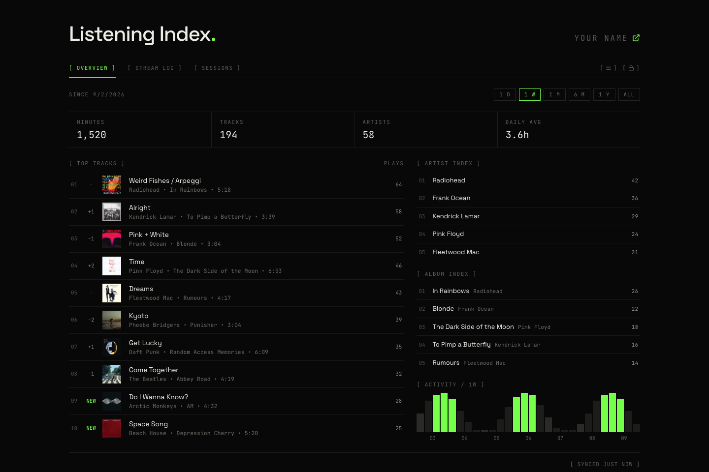
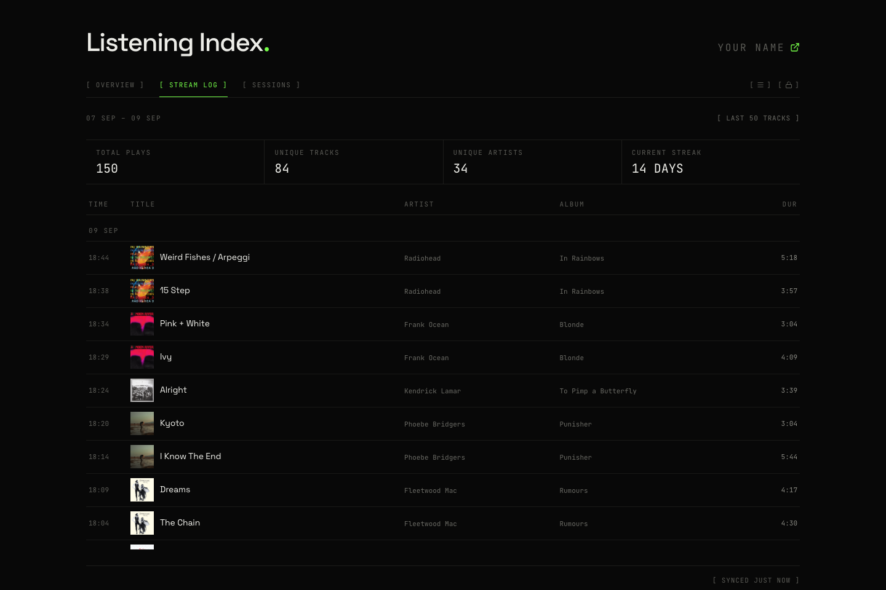
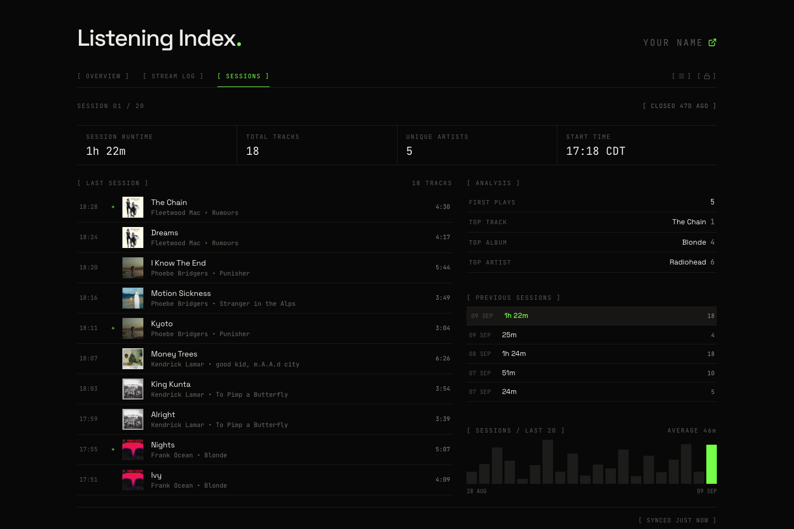
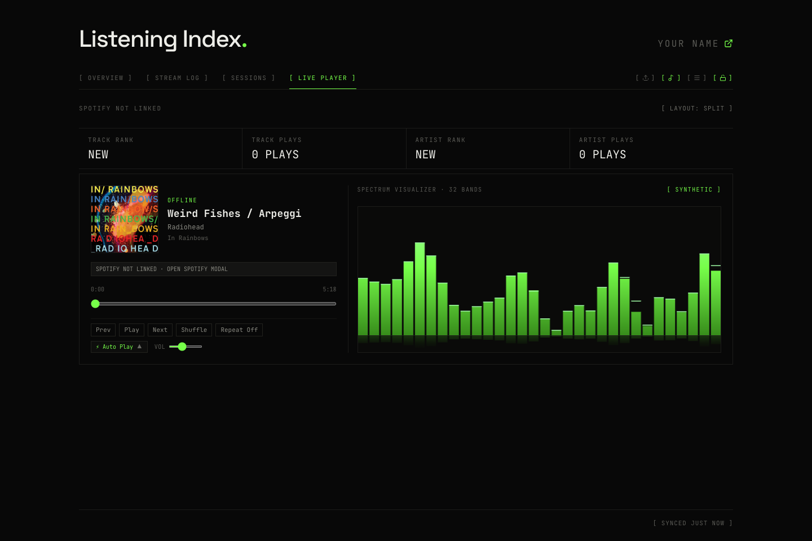
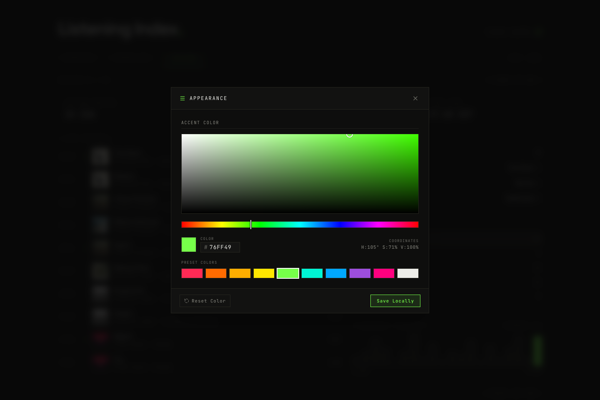
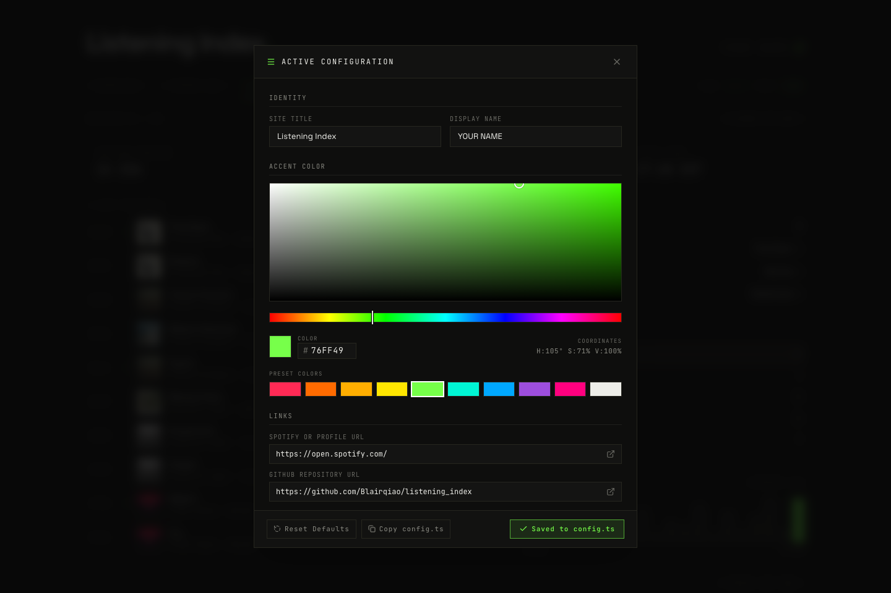
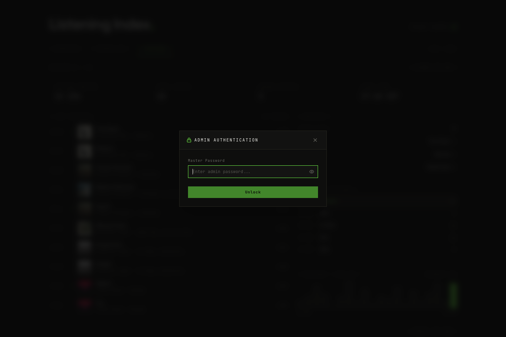
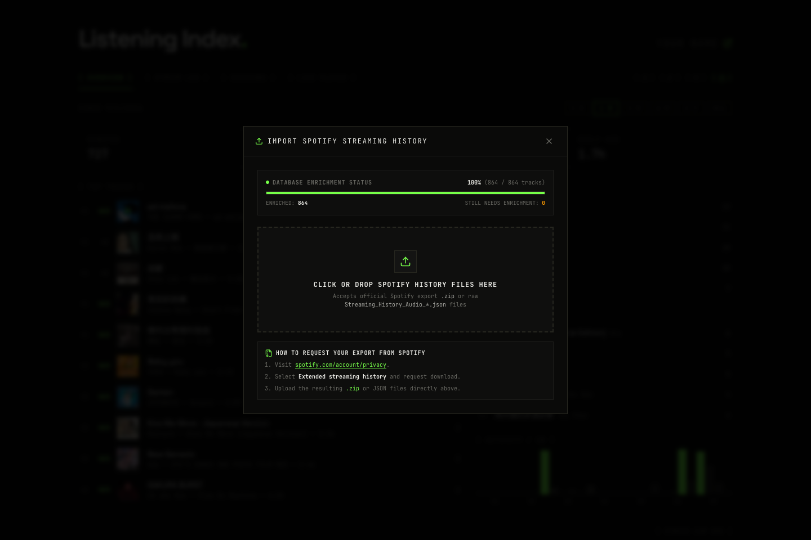
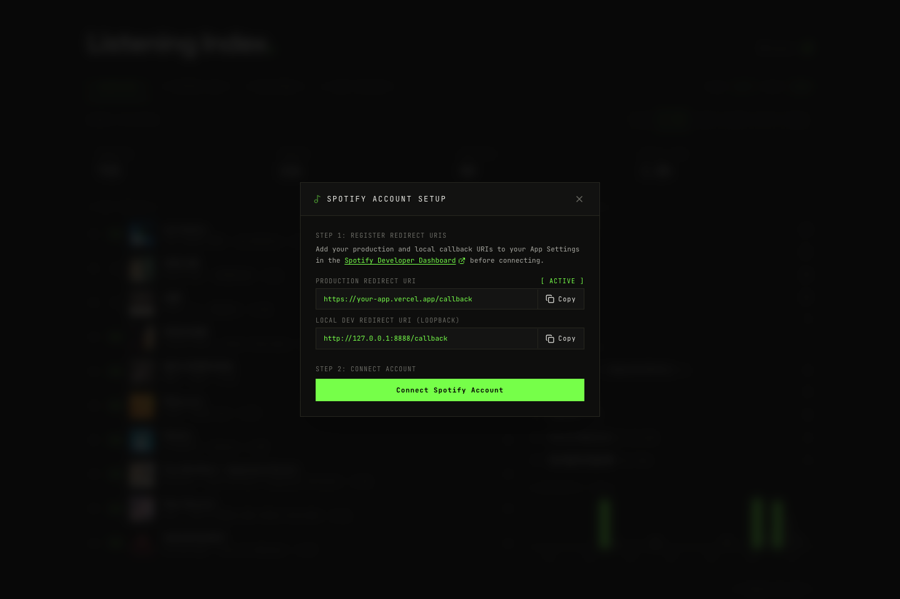
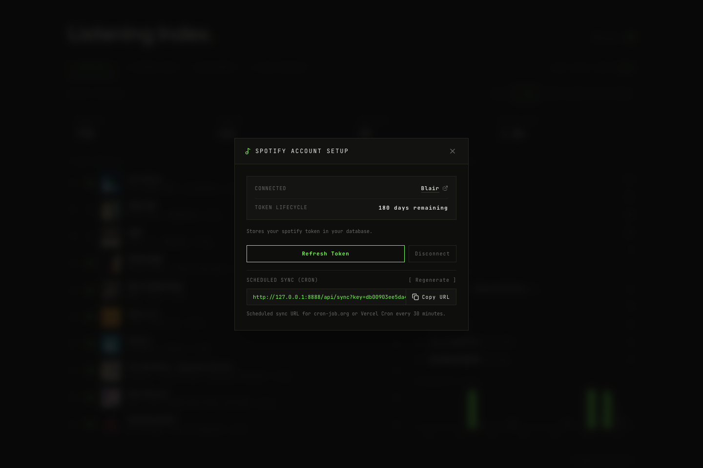

# Listening Index

A personal Spotify dashboard that tracks and stores your streaming history.

[](https://nextjs.org/)
[](https://tailwindcss.com/)
[](https://neon.tech/)

---

## Demo and screenshots

See the [live demo](https://listening-index.vercel.app/) or [run it locally](#local-development) with sample data.

### Overview

Shows listening time, track count, daily averages, rank changes, top tracks and artists, and a listening activity graph across six time ranges.



### Stream log

A chronological list of every track played with timestamps, track lengths, album names, and current day streak.



### Sessions

Groups continuous listening into sessions, marks first-time plays, and tracks session lengths over time.



### Live player

Controls Spotify playback with a 32-band frequency visualizer, split console and stacked stage layouts, and device switching. Shows total plays and archive rank for the current track and artist.

Unlocked with `ADMIN_PASSWORD` via the dedicated admin login modal. Public visitors only see modes 1–3.



### Appearance & configuration

Listening Index decouples visitor personalization from administrative configuration:

- **Visitor Appearance**: Guests can customize their accent color locally in their browser with zero database calls or write permissions.
- **Admin Configuration**: Unlocking admin access allows configuring site title, owner name, external links, and deploying settings permanently to the database.

| Visitor Appearance | Admin Configuration |
| :---: | :---: |
|  |  |

### Admin authentication & history upload

| Dedicated Admin Login | Direct History Import |
| :---: | :---: |
|  |  |

---

## Prerequisites

- A Spotify account with Spotify Premium (required by Spotify to create developer apps and stream audio)
- A GitHub account
- A free [Vercel](https://vercel.com) account
- A free [cron-job.org](https://cron-job.org) account (or any scheduled cron service)

---

## Setup

Setup is split into two straightforward parts: provisioning on Vercel, followed by quick in-app authentication.

### Part 1: Vercel Setup

#### 1. Create New Project
1. Fork this repository to your GitHub account.
2. Go to [vercel.com/new](https://vercel.com/new).
3. Select your forked `listening_index` repository and click **Import**.

#### 2. Add Neon Database
1. In your Vercel project dashboard, navigate to the **Storage** tab.
2. Click **Connect Database** and select **Neon Postgres**.
3. Vercel provisions the database and automatically populates `DATABASE_URL`. The application initializes its database schema on first sync.

#### 3. Setup Environment Variables
1. **Get Spotify API Credentials**:
   - Open the [Spotify Developer Dashboard](https://developer.spotify.com/dashboard) and create a new app:
     - **App name**: `Listening Index`
     - **Redirect URIs**: `https://<your-app>.vercel.app/callback` (add `http://127.0.0.1:8888/callback` if testing locally)
     - **APIs used**: Check **Web API** and **Web Playback SDK**
   - Save your app and open its **Settings** tab to copy your **Client ID** and **Client Secret**.
2. **Configure Variables in Vercel**:
   - In your Vercel project dashboard, go to **Settings** → **Environment Variables**.
   - Copy the template below, replace the values with your credentials, and paste directly into Vercel:

```env
ADMIN_PASSWORD=your_secure_password_here
SPOTIFY_CLIENT_ID=your_spotify_client_id
SPOTIFY_CLIENT_SECRET=your_spotify_client_secret
```

3. Click **Deploy** (or Redeploy if already imported).

---

### Part 2: In-App Setup

After your Vercel deployment completes, open your live URL to finish setup directly in the app.

| Spotify Connection (Refresh Token) | Scheduled Sync (Cron Job) |
| :---: | :---: |
|  |  |

#### 1. Refresh Token (Connect Spotify Account)
1. Click the lock icon in the top navigation bar and enter your `ADMIN_PASSWORD` to log in.
2. Click the music icon in the navigation bar to open the **Spotify Account Setup** modal.
3. Click **[ Connect Spotify Account ]** and authorize your account via the Spotify popup.
4. Your owner refresh token is saved securely to your Neon database, enabling background stream ingestion and live playback without manual token handling. You can re-link or refresh your token at any time by clicking **[ Refresh Token ]**.

#### 2. Cron Job (Scheduled Sync)
Spotify only stores your last 50 played tracks, so a regular sync keeps your history complete.

1. In the **Spotify Account Setup** modal, navigate to **SCHEDULED SYNC (CRON)**.
2. Click **[ Copy URL ]** to copy your unique, pre-authenticated sync URL (`https://<your-app>.vercel.app/api/sync?key=<cron_key>`).
3. In [cron-job.org](https://cron-job.org) (or your preferred cron runner), create a new job:
   - **Title**: `Listening Index Sync`
   - **URL**: Paste your copied Scheduled Sync URL
   - **Schedule**: Every 30 minutes
4. Save the cron job. Your dashboard is now active and will automatically ingest recent plays on schedule. You can rotate your sync key whenever needed using **[ Regenerate ]**.

---

## Extended Listening History Import (Optional)

To backfill your full Spotify streaming history:

1. Request your **Extended streaming history** from the [Spotify Privacy Settings](https://www.spotify.com/account/privacy/) page.
2. Log in as admin by clicking the lock icon in the navigation bar.
3. Click the upload icon in the navigation bar.
4. Drag and drop your downloaded `.zip` file (or individual `endsong_*.json` files).
5. The browser extracts stream events locally, streams them to your database, and enriches track and artist metadata through the two-stage pipeline.

---

## Keeping your fork updated

When new updates are pushed to the main repository:

1. Open your fork on GitHub.
2. Click **Sync fork** → **Update branch**.
3. Vercel automatically deploys the latest version.

---

## Customization

Listening Index separates visitor appearance preferences from owner site configuration:

### For visitors (Appearance)
Click the menu icon in the top navigation bar:
- Select an accent color from the presets or custom picker. The interface updates instantly.
- Click **[ SAVE LOCALLY ]** to keep your choice in browser `localStorage`.
- Click **[ RESET COLOR ]** to restore default styling.

### For administrators (Active configuration)
Log in via the lock icon in the navigation bar, then click the menu icon in the navigation bar:
- Update site title, owner name, Spotify profile link, and GitHub repository link.
- Click **[ DEPLOY TO DATABASE ]** to apply changes permanently for all visitors.
- Click **[ RESET DEFAULTS ]** to restore defaults, or click **[ COPY CONFIG.TS ]** to export active settings as TypeScript code.

To set permanent defaults directly in code, edit `src/config.ts`:

```typescript
export const siteConfig = {
  title: "Listening Index",
  ownerName: "YOUR NAME",
  accentColor: "#76ff49ff",
  siteUrl: "https://open.spotify.com/",
  githubUrl: "https://github.com/Blairqiao/listening_index"
};
```

---

## Environment variables

| Variable | Description | Where to find |
| :--- | :--- | :--- |
| `DATABASE_URL` | Neon PostgreSQL connection string | Vercel Storage tab or Neon dashboard |
| `ADMIN_PASSWORD` | Passphrase authorizing administrative actions (configuration, history upload, playback controls) | Set your own secure passphrase |
| `SPOTIFY_CLIENT_ID` | Spotify developer application client ID | Spotify Developer Dashboard |
| `SPOTIFY_CLIENT_SECRET` | Spotify developer application client secret | Spotify Developer Dashboard |

---

## Local development

Run the site locally with sample mock data:

```bash
git clone https://github.com/Blairqiao/listening-index.git
cd listening-index
npm install
npm run dev
```

Open `http://127.0.0.1:8888`.

To connect real data locally, copy `.env.example` to `.env.local` and add your `DATABASE_URL`, `ADMIN_PASSWORD`, `SPOTIFY_CLIENT_ID`, and `SPOTIFY_CLIENT_SECRET`.

---

## Scripts

| Command | Action |
| :--- | :--- |
| `npm run dev` | Start development server on `http://127.0.0.1:8888` |
| `npm run build` | Build production Next.js application |
| `npm run start` | Start production Next.js server locally |
| `npm run sync` | Ingest recent stream events from Spotify into database |
| `npm test` | Run test suite |

---

## Tech stack

- [Next.js 16](https://nextjs.org/)
- [Neon](https://neon.tech/) Serverless PostgreSQL
- [Tailwind CSS v4](https://tailwindcss.com/)
- Spotify Web API & Spotify Web Playback SDK

---

## License

MIT
